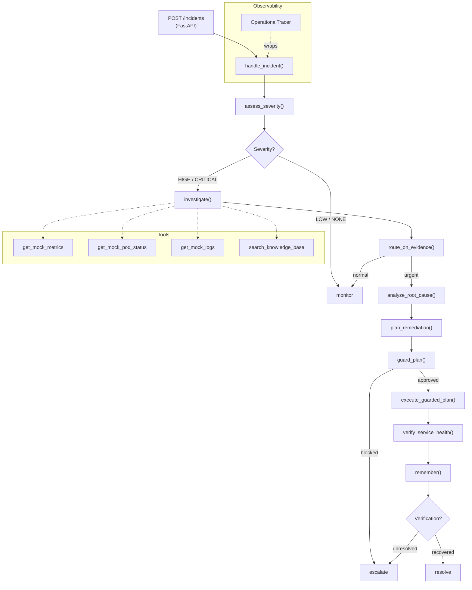

# AI Engineering & Incident Resolution Platform

A production-oriented AI incident-response platform built with **Python 3.10**, **LangGraph**, **FastAPI**, and **Pydantic**. It investigates infrastructure incidents using bounded agent tool use, applies guardrails, executes simulated remediation, verifies recovery, and records learned outcomes to long-term memory — all with structured observability and a golden-dataset evaluation framework.

> **Simulation notice:** Observability tools (metrics, pod status, logs) and remediation execution are deterministic mocks. No real Kubernetes, Prometheus, or Datadog connections are made. LLM calls require either an OpenRouter API key or a running Ollama instance.

---

## Capabilities

| Feature | Status |
|---|---|
| LangGraph multi-step incident workflow | Implemented |
| Severity assessment (HIGH / CRITICAL / LOW / NONE) | Implemented |
| Bounded investigation with mock observability tools | Implemented |
| RAG over synthetic incident runbooks | Implemented |
| Root cause analysis (LLM-driven) | Implemented |
| Remediation planning (LLM-driven) | Implemented |
| Guardrails — blocking and policy enforcement | Implemented |
| Simulated remediation execution | Implemented (mock) |
| Post-remediation verification | Implemented |
| Long-term incident memory (JSONL) | Implemented |
| MCP server for investigation tools | Implemented |
| Structured operational traces | Implemented |
| Golden-dataset evaluation framework | Implemented |
| FastAPI REST service | Implemented |
| Centralized Pydantic configuration | Implemented |
| Docker containerization | Implemented (build not runtime-tested) |
| GitHub Actions CI | Implemented |
| Human-approval gating (Gate B) | Deferred — design in progress |
| Persistent workflow checkpointing | Not implemented (in-memory only) |
| Trace retrieval endpoint | Not implemented |

---

## Architecture



---

## Tech Stack

| Layer | Technology |
|---|---|
| Language | Python 3.10 |
| Workflow orchestration | LangGraph >= 1.2 |
| REST API | FastAPI >= 0.115, uvicorn |
| Data validation | Pydantic v2 |
| Embeddings / RAG | sentence-transformers |
| LLM providers | OpenRouter (cloud) or Ollama (local) |
| MCP integration | mcp >= 2.3 |
| HTTP client | httpx |
| Dependency management | uv |
| Linting / formatting | ruff |
| Testing | pytest |
| Containerization | Docker (multi-stage, non-root) |
| CI | GitHub Actions |

---

## Prerequisites

- **Python 3.10+**
- **[uv](https://docs.astral.sh/uv/)** — `pip install uv` or see official docs
- **LLM provider** — one of:
  - **OpenRouter:** API key from [openrouter.ai/keys](https://openrouter.ai/keys)
  - **Ollama:** running locally with a compatible model (`ollama pull llama3`)

---

## Setup

```bash
# 1. Clone
git clone <repo-url>
cd agentic_AI

# 2. Install all dependencies (including dev)
uv sync --frozen --all-groups

# 3. Configure environment
cp .env.example .env
# Edit .env — set LLM_PROVIDER, OPENROUTER_API_KEY (or OLLAMA_MODEL)
```

### Environment Variables

| Variable | Default | Description |
|---|---|---|
| `LLM_PROVIDER` | `openrouter` | `openrouter` or `ollama` |
| `OPENROUTER_API_KEY` | — | Required when using OpenRouter |
| `OPENROUTER_MODEL` | `openai/gpt-4o-mini` | Model name for OpenRouter |
| `OLLAMA_MODEL` | `llama3` | Model name for Ollama |
| `AGENTIC_MEMORY_PATH` | `.agentic_memory/incidents.jsonl` | Incident memory file |
| `LOG_LEVEL` | `INFO` | `DEBUG`, `INFO`, `WARNING`, `ERROR`, `CRITICAL` |
| `API_HOST` | `0.0.0.0` | FastAPI bind host |
| `API_PORT` | `8000` | FastAPI bind port |
| `AGENTIC_MCP_SCENARIO` | `connection_pool_exhaustion` | MCP server scenario |

---

## Running the API Service

```bash
uv run uvicorn agentic_ai.api.app:app --host 0.0.0.0 --port 8000 --reload
```

### API Endpoints

#### `GET /health` — Liveness probe

```bash
curl http://localhost:8000/health
```

```json
{"status": "ok", "service": "agentic-ai", "version": "0.1.0"}
```

#### `GET /ready` — Readiness probe

```bash
curl http://localhost:8000/ready
```

```json
{
  "status": "ready",
  "llm_provider": "openrouter",
  "model": "openai/gpt-4o-mini",
  "configured": true,
  "connectivity_verified": false,
  "details": "OpenRouter configured with credentials (connectivity not verified)."
}
```

#### `POST /incidents` — Submit an incident

```bash
curl -X POST http://localhost:8000/incidents \
  -H "Content-Type: application/json" \
  -d '{
    "incident_description": "High error rate on payment-service, P95 latency > 5000ms",
    "scenario": "connection_pool_exhaustion"
  }'
```

```json
{
  "incident_id": "INC-a3f2c1b4",
  "correlation_id": "CORR-9e7d1234",
  "outcome": "escalate",
  "severity": "HIGH",
  "diagnostic": {
    "decision": "escalate",
    "trigger_type": "verification_unresolved",
    "primary_reason": "Service health could not be confirmed after remediation"
  },
  "verification": {
    "status": "unresolved",
    "attempts": 2,
    "reasons": ["Connection pool still exhausted after scale-up"]
  },
  "trace": { "..." : "..." }
}
```

**Request fields:**

| Field | Type | Required | Description |
|---|---|---|---|
| `incident_description` | string (1–4000 chars) | Yes | Observed symptoms or alert text |
| `scenario` | enum | No | `connection_pool_exhaustion`, `upstream_dependency_failure`, `healthy` |
| `post_remediation_scenario` | enum | No | Post-remediation mock scenario override |
| `incident_id` | string (max 100) | No | Caller-supplied incident ID |
| `correlation_id` | string (max 100) | No | Distributed tracing correlation ID |

---

## CLI Demo

Run a simulated incident investigation from the command line without the API server:

```bash
# Default scenario (connection_pool_exhaustion)
uv run agentic-ai-demo

# Select a scenario
uv run agentic-ai-demo --scenario healthy
uv run agentic-ai-demo --scenario upstream_dependency_failure

# Custom description
uv run agentic-ai-demo \
  --description "Database latency spike on auth-service" \
  --scenario connection_pool_exhaustion \
  --post-remediation-scenario healthy
```

**Available scenarios:**

| Scenario | Description |
|---|---|
| `connection_pool_exhaustion` | Database connection pool saturated — leads to escalation |
| `upstream_dependency_failure` | Service is healthy; downstream API is failing |
| `healthy` | No incident — workflow routes to monitor |

---

## MCP Server

Expose investigation tools to any MCP-compatible client (IDE plugins, other agents):

```bash
uv run agentic-ai-mcp
```

Exposes four read-only tools: `get_mock_metrics`, `get_mock_pod_status`, `get_mock_logs`, `search_knowledge_base`. Remediation tools are intentionally absent from the MCP interface.

---

## Testing

```bash
# Run the full test suite
uv run pytest

# Run with verbose output
uv run pytest -v

# Run a specific module
uv run pytest tests/test_incident_workflow.py -v

# Run the evaluation framework (requires LLM credentials)
uv run pytest tests/test_evaluation.py -v
```

**Test coverage by area:**

| Module | Tests |
|---|---|
| Incident workflow | `test_incident_workflow.py` |
| Configuration | `test_config.py` |
| API layer | `test_api.py` |
| CLI demo | `test_cli.py` |
| Observability / tracer | `test_observability.py`, `test_tracer.py`, `test_workflow_observability.py` |
| Remediation & verification | `test_mock_remediation.py`, `test_verification.py`, `test_execution_models.py` |
| Evaluation framework | `test_evaluation.py` |

---

## Code Quality

```bash
# Lint
uv run ruff check .

# Format check
uv run ruff format --check src/agentic_ai/config.py src/agentic_ai/api \
    src/agentic_ai/cli.py tests/test_config.py tests/test_api.py tests/test_cli.py

# Lock file consistency
uv lock --check
```

---

## Docker

```bash
# Build the image
docker build -t agentic-ai:latest .

# Run the container
docker run --rm -p 8000:8000 \
  -e LLM_PROVIDER=openrouter \
  -e OPENROUTER_API_KEY=sk-or-... \
  agentic-ai:latest

# Health check
curl http://localhost:8000/health
```

> **Note:** The Docker image was built and inspected statically. Runtime validation was not performed because Docker Desktop was not running during development. The image uses a non-root `appuser` (UID 10001) and a stdlib `HEALTHCHECK`.

---

## CI / CD

GitHub Actions workflow at [`.github/workflows/ci.yml`](.github/workflows/ci.yml):

- **Linting:** `ruff check .`
- **Format check:** `ruff format --check` on formatted files
- **Lock file check:** `uv lock --check`
- **Test suite:** `uv run pytest` (offline-safe tests only — tests requiring live LLM credentials are excluded in CI via markers)

---

## Repository Structure

```
agentic_AI/
├── src/agentic_ai/
│   ├── __init__.py              # Package entry point
│   ├── cli.py                   # CLI demo (agentic-ai-demo)
│   ├── config.py                # Centralized Pydantic Settings
│   ├── api/
│   │   ├── app.py               # FastAPI application
│   │   └── schemas.py           # Request / response models
│   ├── agents/
│   │   └── investigation.py     # Investigation agent (bounded tool use)
│   ├── domain/
│   │   ├── escalation.py        # Evidence-based escalation policy
│   │   ├── guardrails.py        # Remediation guardrails
│   │   ├── incident.py          # Incident and Severity models
│   │   ├── investigation.py     # Investigation result models
│   │   ├── knowledge.py         # Knowledge / runbook models
│   │   ├── rca.py               # Root cause analysis models
│   │   ├── remediation.py       # Remediation plan and execution models
│   │   └── verification.py      # Verification result models
│   ├── evaluation/
│   │   ├── dataset.py           # Golden dataset
│   │   ├── metrics.py           # Evaluation metrics
│   │   ├── models.py            # Evaluation models
│   │   └── runner.py            # Evaluation runner
│   ├── llm/
│   │   ├── client.py            # LLM client abstraction
│   │   ├── rca.py               # Root cause analysis LLM calls
│   │   ├── remediation.py       # Remediation planning LLM calls
│   │   ├── severity.py          # Severity assessment LLM calls
│   │   └── providers/           # OpenRouter and Ollama providers
│   ├── mcp_server/
│   │   └── server.py            # MCP server (read-only investigation tools)
│   ├── observability/
│   │   ├── events.py            # Trace domain models
│   │   ├── redaction.py         # Credential redaction
│   │   └── tracer.py            # OperationalTracer
│   ├── tools/
│   │   ├── incident_memory.py   # JSONL long-term memory
│   │   ├── mock_remediation.py  # Simulated remediation execution
│   │   ├── mock_tools.py        # Deterministic observability mocks
│   │   ├── mock_verification.py # Simulated health verification
│   │   ├── registry.py          # Tool dispatch registry
│   │   └── search_tool.py       # Knowledge base search (RAG)
│   └── workflows/
│       └── incident.py          # handle_incident() — main entry point
├── tests/                       # 432 tests across 25 modules
├── Dockerfile                   # Multi-stage production image
├── .dockerignore
├── .github/workflows/ci.yml     # GitHub Actions CI
├── .env.example                 # Environment variable template
├── pyproject.toml               # Project metadata, deps, ruff config
└── uv.lock                      # Locked dependency manifest
```

---

## Limitations & Roadmap

### Current Limitations

- **Mock infrastructure only:** Observability tools (`get_mock_metrics`, `get_mock_pod_status`, `get_mock_logs`) return deterministic JSON fixtures. No real Kubernetes, Prometheus, Datadog, or Grafana connections exist.
- **Simulated remediation:** Remediation execution does not touch real services. Changes are recorded in the workflow state only.
- **In-memory workflow state:** LangGraph uses no persistent checkpointer. Workflow state is lost on process restart. No SQLite, Redis, or external store is configured.
- **Traces not persisted:** Operational traces are returned in the API response but not stored. There is no trace retrieval endpoint.
- **Gate B approval deferred:** Human-approval gating before remediation execution requires plan fingerprinting design and is not yet implemented.
- **Docker runtime unvalidated:** The Docker image was built and inspected statically. End-to-end container runtime validation was not performed.
- **GitHub Actions not yet triggered:** CI workflow file exists and is correct; it has not been triggered on GitHub because no commit/push has been made.

### Roadmap

- Persistent LangGraph checkpointer (SQLite or Redis)
- Gate B: human-approval webhook before remediation
- Real observability integrations (Prometheus, Datadog)
- Trace retrieval API endpoint
- Role-based access control on the API
- Streaming incident response via Server-Sent Events
- Dashboard UI for incident history

---

## License

Internal engineering platform. See repository for license terms.
